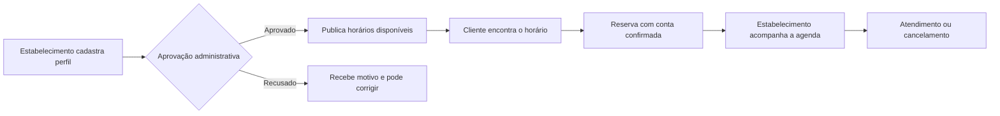
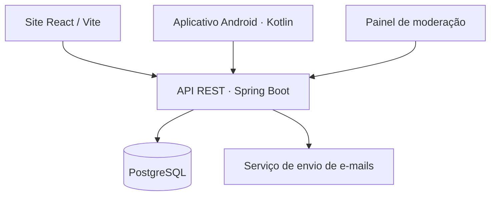

<div align="center">

# Valtrea Agora

**Encontre horários disponíveis perto de você. Reserve para hoje.**

Plataforma para divulgar e reservar horários vagos em salões, barbearias e outros estabelecimentos de serviços locais — com busca pública, reservas gratuitas no aplicativo e atendimento pago diretamente no estabelecimento.

[**Acessar o site**](https://agora.valtrea.com.br/) · [**Repositório**](https://github.com/adolfo-araujo/valtrea-agora)

**Java 21** · **Spring Boot 4.1** · **PostgreSQL** · **React** · **Kotlin** · **Docker**

</div>

---

## Visão geral

O **Valtrea Agora** conecta estabelecimentos com horários vagos a pessoas que procuram serviços na região, inclusive no mesmo dia. Estabelecimentos aprovados publicam horários e acompanham sua agenda; clientes pesquisam, reservam e gerenciam os agendamentos em um só lugar.

A consulta de horários e estabelecimentos é pública. Para reservar, cadastrar um estabelecimento ou fazer uma denúncia, é preciso criar uma conta e confirmar o e-mail.

> **Importante:** a plataforma não cobra pela reserva dentro do aplicativo. Os preços exibidos são informativos; eventual pagamento pelo serviço é realizado **no estabelecimento**. O projeto não processa cartão, Pix ou outros pagamentos pelo aplicativo.

## Funcionalidades

### Para clientes

- Buscar horários por **estado, cidade, bairro e tipo de serviço**.
- Consultar horários e estabelecimentos aprovados sem criar conta.
- Visualizar horários disponíveis nos próximos **7 dias**.
- Reservar um horário e acompanhar suas reservas futuras.
- Cancelar uma reserva antes do atendimento e receber notificações por e-mail.
- Denunciar estabelecimentos quando necessário.

### Para estabelecimentos

- Cadastrar estabelecimentos com nome, categoria, endereço e telefone, sujeitos à aprovação administrativa.
- Publicar até **20 horários por operação**, entre **10 minutos e 60 dias** a partir do momento do cadastro.
- Informar o serviço, a duração e o preço de referência dos atendimentos.
- Gerenciar a agenda, acompanhar reservas e registrar atendimentos concluídos ou ausências.
- Cancelar reservas e receber notificações por e-mail.

### Para administração

- Analisar pedidos de cadastro de estabelecimentos, aprovando ou recusando com justificativa.
- Acompanhar denúncias: após **3 denúncias de clientes diferentes**, um estabelecimento sai da busca e retorna à fila de análise.
- Consultar métricas agregadas por meio de uma rota administrativa.

## Como funciona



**Regras de reserva descritas no projeto:** até **3 reservas futuras por pessoa**; na concorrência pelo mesmo horário, a lógica de bloqueio e o índice único parcial do banco são usados para evitar reservas duplicadas. Quando o cliente cancela antes do horário, a vaga volta a ficar disponível; quando o estabelecimento cancela, não volta automaticamente.

## Tecnologias e arquitetura

| Camada | Diretório | Tecnologias | Ambiente documentado |
|---|---|---|---|
| API | `api/` | Java 21, Spring Boot 4.1, PostgreSQL, Flyway | Render |
| Aplicação web | `web/` | React, Vite, Tailwind CSS | Vercel |
| Aplicativo Android | `android/` | Kotlin, Jetpack Compose | Android / distribuição conforme a versão do app |



- A API concentra autenticação, regras de disponibilidade, reservas, gestão de estabelecimentos e moderação.
- O frontend web permite consultas públicas e os fluxos de usuários autenticados.
- O aplicativo Android oferece acesso móvel às funcionalidades compatíveis com sua versão.
- O Flyway organiza a evolução do esquema do banco.

## Segurança e privacidade

Os seguintes controles são **descritos na implementação/documentação do projeto** (não equivalem a uma auditoria de segurança independente):

- Cadastro e operações privadas exigem confirmação de e-mail.
- Na visualização do estabelecimento, apenas o primeiro nome do cliente é exibido, sem expor seu e-mail ou as reservas de terceiros.
- Estabelecimentos não aprovados ou em análise não são exibidos publicamente; a API usa respostas 404 para recursos não acessíveis.
- Controle de concorrência para impedir reservas simultâneas do mesmo horário.
- Limites por IP para operações de reserva, cancelamento, publicação de horários e denúncia.
- Recursos administrativos restritos a usuários autorizados.
- Exclusão de conta e regras de retenção de dados documentadas.
- Controles adicionais descritos: hash de senhas com bcrypt, sessões, CORS restrito, cabeçalhos de segurança, backups e verificações automatizadas.

**Retenção documentada:** horários e reservas até 90 dias após o horário; cadastros não confirmados até 30 dias; solicitações recusadas sem correção até 30 dias. Confira a política vigente antes de usar esses prazos como compromisso público.

## API REST

Prefixo das rotas: `/api/v1`. A documentação interativa é apresentada em `/swagger-ui.html` no ambiente em que a API estiver disponível.

| Método | Endpoint | Finalidade |
|---|---|---|
| `POST` | `/auth/cadastro`, `/auth/login`, `/auth/renovar`, `/auth/sair` | Conta e sessão |
| `POST` | `/auth/confirmar-email`, `/auth/reenviar-confirmacao` | Confirmação de e-mail |
| `POST` | `/auth/esqueci-senha`, `/auth/redefinir-senha` | Recuperação de acesso |
| `GET`, `PATCH`, `DELETE` | `/eu` | Consultar, alterar ou excluir a conta |
| `GET` | `/eu/dados` | Exportar os próprios dados em JSON |
| `POST` | `/eu/termos` | Aceitar termos vigentes |
| `GET` | `/publico/horarios`, `/publico/estabelecimentos` | Busca pública |
| `GET` | `/publico/estabelecimentos/{id}` | Detalhes públicos |
| `GET` | `/estabelecimentos/{id}` | Detalhes para usuário autenticado |
| `POST` | `/horarios/{id}/reserva` | Reservar um horário |
| `GET` | `/eu/reservas` | Consultar as próprias reservas |
| `POST` | `/reservas/{id}/cancelar`, `/reservas/{id}/status` | Cancelamento e presença |
| `GET`, `POST` | `/eu/estabelecimentos`, `/estabelecimentos` | Gerenciar cadastro de estabelecimentos |
| `PUT`, `DELETE` | `/estabelecimentos/{id}` | Editar ou excluir estabelecimento |
| `GET`, `POST` | `/estabelecimentos/{id}/agenda`, `/estabelecimentos/{id}/horarios` | Agenda e horários |
| `DELETE` | `/horarios/{id}` | Excluir horário sem reserva |
| `POST` | `/estabelecimentos/{id}/denuncia` | Denunciar estabelecimento |
| `GET`, `POST` | `/admin/estabelecimentos`, `/admin/estabelecimentos/{id}/aprovar`, `/admin/estabelecimentos/{id}/recusar` | Moderação |
| `GET` | `/admin/metricas` | Indicadores agregados |

> Consulte o Swagger e o código-fonte para confirmar os corpos das requisições, respostas e permissões de cada endpoint.

## Executar localmente

### Pré-requisitos

- **JDK 21** e Maven compatível com o projeto.
- **Node.js** e npm.
- **Docker**, caso use o PostgreSQL em container.
- Variáveis de ambiente configuradas conforme os arquivos da API (sem inserir segredos no Git).

### 1. Banco PostgreSQL

Configure uma instância local do PostgreSQL, preferencialmente pelo Docker, com banco, usuário e **senha próprios de desenvolvimento**. Conecte a API a essa instância com as propriedades ou variáveis exigidas pelo projeto.

### 2. Backend

No terminal, a partir da raiz do repositório:

```bash
cd api
# Configure o banco e os segredos localmente antes de iniciar
mvn spring-boot:run
```

A API utiliza, entre outras, variáveis como `VALTREA_JWT_SECRET`, `VALTREA_URL_SITE`, `VALTREA_CORS` e as credenciais do banco. Gere um segredo JWT forte e nunca o envie ao GitHub.

### 3. Frontend

Em outro terminal, a partir da raiz do repositório:

```bash
cd web
npm install
npm run dev
```

No ambiente de desenvolvimento mostrado na documentação, o site usa `http://localhost:5175` e a API a porta `8080`. Confira as portas na configuração atual.

**E-mails locais:** conforme o README anterior, quando não há SMTP configurado, códigos e avisos podem aparecer nos logs da API. Essa opção deve ficar restrita ao desenvolvimento; **não registre códigos sensíveis em produção**.

**Android:** abra `android/` no Android Studio, verifique a URL da API configurada para a variante desejada e execute no emulador ou dispositivo.

## Implantação

O roteiro documentado para este repositório utiliza:

1. **PostgreSQL gerenciado**, com migrações Flyway.
2. **Render** para a API em `api/`, configurando `DATABASE_URL`, `DATABASE_USER`, `DATABASE_PASSWORD` e integração de e-mail como `RESEND_API_KEY`, quando aplicável.
3. **Vercel** para a aplicação em `web/`, com `VITE_API_URL` apontando para a API implantada.
4. **DNS** para o domínio do site, caso utilizado.
5. Configuração separada da URL da API para a variante de produção do aplicativo Android.

> Endereços de referência documentados: `https://agora.valtrea.com.br/` (site) e `https://valtrea-agora-api.onrender.com/` (API). A disponibilidade desses endereços não foi verificada nesta revisão.

## Próximos passos de documentação

- Adicionar capturas reais de **busca**, **reserva** e **agenda do estabelecimento**.
- Adicionar um vídeo curto demonstrando o fluxo completo de reserva.
- Documentar os comandos de testes e os resultados do CI, depois de confirmá-los no repositório.
- Incluir um diagrama do modelo de dados e os principais relacionamentos.
- Separar instruções avançadas de deploy e a referência completa da API em `docs/`, para manter este README mais objetivo.

## Projeto

Desenvolvido no contexto dos produtos digitais da **Valtrea**, com foco em disponibilidade de serviços locais, experiência do usuário e organização de reservas.

**Site institucional:** https://www.valtrea.com.br/

---

*Esta documentação foi reorganizada a partir do README apresentado em capturas de tela. Revise as variáveis de ambiente, URLs e rotas de acordo com o código atual antes de publicar alterações.*
